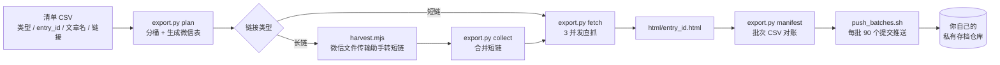

# 微信公众号文章批量导出

**wechat-article-export** —— 给 AI Agent 用的公众号文章批量存档 skill：吃一张清单，吐出整页 HTML，按 `entry_id` 命名，自动对账，分批推送到你自己的 GitHub 存档仓库。

[](LICENSE)
[](scripts/export.py)
[](scripts/harvest.mjs)
[](#已知限制)
[](SKILL.md)
[](#安全与合规)

---

## 它解决什么问题

公众号文章有两个坑，手工存会反复踩：

1. **长链在微信外打不开。** `https://mp.weixin.qq.com/s?__biz=...&mid=...&idx=...&sn=...` 这种长链必须经微信内置浏览器才能拿到可直抓的短链 `https://mp.weixin.qq.com/s/XXXXXXXX`。
2. **批量抓会撞风控。** 返回 17 KB 左右的壳页不是失败，是风控，要退避重试；文章被删、账号注销、需要"使用完整服务"的空壳页又各有各的判定方式，混在一起就会误判死。

这个 skill 把这两件事拆开：**短链走纯 HTTP 并发直抓，长链交给微信桌面端转短链，判定规则固定成表**，最后按批次提交，避免大目录一次 push 被断连。

## 工作流



## 输出约定

| 路径 | 内容 |
|---|---|
| `html/<entry_id>.html` | 整页页面源码，文件名即 `entry_id` |
| `html/_manifest-<批次名>.csv` | 对账清单：entry_id、类型、文章名称、链接、状态、文件 |
| `work/<批次名>/` | 中间态：待抓表、短链 jsonl、失败/失效 jsonl，可直接重跑 |

不额外造目录层级，图片保持页面里的远程地址——**存的是"当时那一眼"的整页快照**，不是清洗后的正文。

## 快速开始

### 1. 前置条件

- **微信桌面端已登录**，主窗口停在「文件传输助手」，跑批期间不要动鼠标键盘（长链转短链靠模拟真人操作）。
- **macOS + Qoder CN 的 computer-use 运行时**（当前仅 macOS 适配，见[已知限制](#已知限制)）。
- `gh auth status` 正常。
- **一个自己的私有存档仓库**（建议 `you/wechat-article-archive`），没有就 `gh repo create --private` 建一个。

### 2. 准备清单

`清单.csv`（UTF-8，可带 BOM）：

```csv
类型,entry_id,文章名称,链接
短链,3072461846,越野跑补给策略,https://mp.weixin.qq.com/s/XXXXXXXX
长链,3072461847,马拉松赛前两周,https://mp.weixin.qq.com/s?__biz=...&mid=...&idx=1&sn=...
```

### 3. 跑五步

```bash
export SK=<本仓库>/scripts
export LIST=清单.csv
export STATE=work/batch-001
export REPO=/path/to/wechat-article-archive

# 1) 分桶，生成微信要用的长链表
python3 $SK/export.py plan --list "$LIST" --repo "$REPO" --state "$STATE"

# 2) 短链直接抓（3 并发，自动重试）
python3 $SK/export.py fetch --state "$STATE" --repo "$REPO" --workers 3

# 3) 长链走微信转短链（约 25–30 秒/条，只处理还待抓的）
QODER_HOME="$HOME/.qoder-cn" \
QODER_CU_BINARY_PATH="$HOME/.qoder-cn/bin/qoder-cn-computer-use/Qoder CN Computer Use.app" \
caffeinate -dims node $SK/harvest.mjs \
  --table "$STATE/wechat-table.txt" \
  --out "$STATE/shortlinks.jsonl" \
  --fail "$STATE/failures.jsonl"
```

## 命令速查

| 命令 | 作用 |
|---|---|
| `export.py plan` | 读清单，分桶（短链直抓 / 长链待转），打印分桶结果 |
| `export.py fetch` | 并发抓取短链，落 `html/<entry_id>.html`，带退避重试 |
| `export.py collect` | 把新拿到的短链并回状态目录 |
| `export.py manifest` | 生成批次对账 CSV，打印各状态计数 |
| `export.py status` | 随时看进度 |
| `harvest.mjs` | 长链 → 微信内置浏览器 → 复制短链 → 写 jsonl |
| `push_batches.sh` | 按 90 个/批提交推送，失败自动重试 3 次（每次退避 30 秒） |

## 判定规则（照这张表，别凭感觉）

| 观察到的现象 | 判定 |
|---|---|
| 页面含 `id="js_content"`（普通文章）或 `content_noencode`（小绿书图文） | ✅ 成功 |
| 响应 `< 200 KB`（常见 17 KB 壳页） | ⏳ 风控，**退避重试**，不要判死 |
| `该内容已被发布者删除` | ☠️ dead |
| `此账号已自主注销` | ☠️ dead |
| ≈2.6 MB、只有"使用完整服务"的空壳 | ⚠️ no_content（需微信内打开），先检查是不是漏了小绿书 |
| `copy link failed` | 只试一次，写入 `dead.jsonl` 后跳过 |

## 验证跑批是否完整

- 清单行数 = 输入 CSV 行数；
- **有文件数 + 各 dead / no_content 数 = 总数**；
- 推送后 `git rev-parse HEAD` 与 `git ls-remote origin main` 一致，`git status` 干净。

## 目录结构

```text
.
├── SKILL.md              # Agent 可直接加载的 skill 说明（流程、判据、环境备忘）
├── agents/openai.yaml    # skill 元数据（显示名、默认提示词）
└── scripts/
    ├── export.py         # 主控：plan / fetch / collect / manifest / status
    ├── harvest.mjs       # 长链转短链（微信 UI 自动化）
    ├── human_mouse.py    # 系统级鼠标事件（绕开 CUA 的"用户正在操作"保护）
    ├── human_key.py      # 系统级按键事件
    └── push_batches.sh   # 分批提交推送
```

## 已知限制

- **仅 macOS**：`harvest.mjs` 的 computer-use 入口、`human_key.py` / `human_mouse.py` 都直接调用 macOS 的 `CGEvent` 与 `/Applications` 路径；Windows / Linux 未适配。
- **依赖微信 UI 现状**：微信改版、深浅色主题、AX 无响应都会影响抓取；`SKILL.md` 里记了对应的排查办法（退出重开微信、按手机确认登录等）。
- **长链慢**：微信里一次复制约 25–30 秒/条，是并发不起来的部分；短链那一段可以 3 并发。
- **只存不洗**：存的是整页 HTML 快照，不做正文抽取、不做去广告。需要正文请配合别的抓取/清洗工具。

## 安全与合规

- 全程在你本机运行，**无遥测、无第三方服务**；登录态只存在于你自己的微信和 `gh` 凭据里。
- 只导出你**有权访问**的内容；整页 HTML 含正文、图片地址与页面结构，请存入**私有仓库**，不要公开分发。
- 存档目的是个人阅读/研究留痕。请自行遵守微信公众平台规则与文章版权，尊重作者，不批量搬运、不二次发布。

## 作为 Agent Skill 使用

`SKILL.md` 顶部带 YAML front matter（`name` / `description`），可直接被支持 skill 的 Agent 客户端加载；`agents/openai.yaml` 提供 OpenAI 风格的展示元数据。加载后对 Agent 说「用 wechat-article-export 抓取这批文章并推送到仓库」即可。

## License

[MIT](LICENSE) © 2026 PakhomLeo
